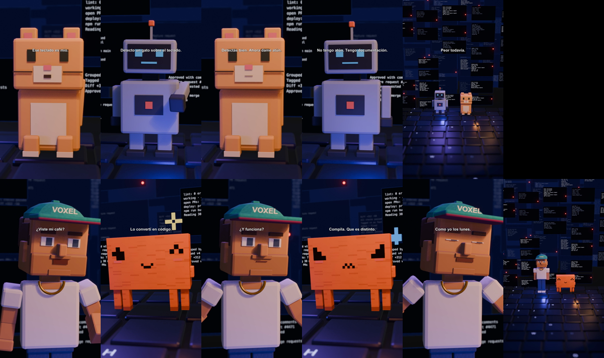

<div align="center">

# Voxel Factory

**Le decís a tu agente _«un robot y un gato discuten por el teclado»_ y te devuelve un MP4 vertical animado, con voces y subtítulos.**

[](#qué-no-hace)
[](https://python.org)
[](https://www.blender.org/download/)
[](https://modal.com)
[](https://mats2208.github.io/voxel-factory/)
[](LICENSE)

<br/>

<table>
<tr>
<td align="center"><strong>11</strong><br/><sub>subcomandos CLI</sub></td>
<td align="center"><strong>16</strong><br/><sub>emociones</sub></td>
<td align="center"><strong>10</strong><br/><sub>íconos pixelados</sub></td>
<td align="center"><strong>9</strong><br/><sub>comprobaciones por MP4</sub></td>
<td align="center"><strong>0</strong><br/><sub>dependencias pip</sub></td>
</tr>
</table>

**🎬 Demos:** [mats2208.github.io/voxel-factory](https://mats2208.github.io/voxel-factory/) &nbsp;•&nbsp; **🤖 Guía para agentes:** [AGENTS.md](AGENTS.md)

</div>

---

<p align="center"></p>
<p align="center"><sub>Cada cuadro es un plano distinto que eligió la fábrica: un primer plano por línea de diálogo y un plano general alejado al final. Ninguno se encuadró a mano.</sub></p>

**Contenido:** [Qué hace](#qué-hace) · [Pensado para agentes](#pensado-para-agentes) · [Install](#install) · [Uso](#uso) · [Local o Modal](#local-o-modal) · [Cómo funciona](#cómo-funciona) · [Qué no hace](#qué-no-hace)

## Qué hace

Partís de un guion JSON con personajes y líneas de diálogo. La fábrica hace todo lo demás:

- **Voces.** Sintetiza cada línea con `say` (macOS), espeak-ng o ElevenLabs, mide cuánto dura y recorta el silencio. Con eso calcula los tiempos solo.
- **Actuación.** Sincroniza la boca con el audio y, si la voz viene de ElevenLabs, con cada palabra. Además dispara gestos e íconos (sudor, corazón, zzz, idea…) en el instante en que el personaje dice ciertas palabras.
- **Cámaras.** Arma un primer plano por línea y un plano general alejado de cierre, con perspectiva, desenfoque de fondo y etalonaje AgX.
- **Personajes.** Trae tres tipos (`person`, `cube`, `custom`) y presets armados con piezas en JSON (`robot`, `cat`). Un personaje nuevo es un archivo, no código.
- **Salida.** Renderiza en Blender sin abrirlo, en local o repartido en GPUs de Modal. Une imagen, audio y subtítulos quemados en un MP4 H.264/AAC.
- **Verificación.** Antes de dar el video por bueno, decodifica el MP4 entero y comprueba el formato vertical, el audio en cada línea y los subtítulos al inicio, en el medio y al final de cada intervalo.

## Pensado para agentes

La CLI está diseñada para que **otro agente** (Claude Code, Codex, Cursor) pueda hacer un video sin ayuda:

- [`AGENTS.md`](AGENTS.md) explica cómo pasar de un pedido en lenguaje natural a un guion.
- `voxel.py schema` imprime todos los campos y valores válidos.
- `validate` lista **todos** los errores con su ruta (`shots[2].acting.B.emotion`) y una sugerencia.
- Cada comando acepta `--json` y termina con códigos estables: 0 bien, 2 guion inválido, 3 falta una dependencia, 4 falló el render, 5 la verificación no pasó.

No hay servidor MCP porque no hace falta: cualquier agente con terminal ya puede usarlo.

## Install

Requisitos: Python 3.10 o posterior, [Blender](https://www.blender.org/download/) 4.2+ (probado con 5.2 LTS), FFmpeg **con libass** y ffprobe.

```sh
git clone https://github.com/Mats2208/voxel-factory.git
cd voxel-factory
brew install ffmpeg-full            # en Linux: apt install ffmpeg espeak-ng
python3 voxel.py doctor             # dice qué falta y cómo instalarlo
```

No hay `pip install`: la fábrica usa solo la biblioteca estándar. Las dos integraciones son opcionales:

```sh
cp .env.example .env                    # clave de ElevenLabs y cuenta de Modal; nunca se sube
uv tool install modal && modal setup    # solo para renderizar en la nube
```

## Uso

1. **Guion** desde líneas de diálogo. Las etiquetas entre corchetes son emoción, pose o plano:

   ```sh
   python3 voxel.py new -o videos/teclado/guion.json --cast A=robot,B=cat \
     --line "B: Ese teclado es mío." \
     --line "A: Detecto un gato sobre el teclado." \
     --line "B[wide]: Peor todavía."
   ```

2. **Validación**: sintetiza las voces y resuelve tiempos y planos. Después, una **muestra** de 3 s verificada:

   ```sh
   python3 voxel.py validate videos/teclado/guion.json
   python3 voxel.py preview  videos/teclado/guion.json
   ```

3. **Toma final**, local o en GPUs de Modal. Queda en `videos/teclado/tomas/toma-01/` (`video.mp4`, `video.srt`, `escena.blend`, `verificacion.json`):

   ```sh
   python3 voxel.py render videos/teclado/guion.json --cloud modal
   ```

4. **La escena en tu Blender**, por la cámara y sin renderizar:

   ```sh
   python3 voxel.py open videos/teclado
   ```

Hay dos guiones listos en [`examples/`](examples). Un guion mínimo se ve así; la fábrica completa los tiempos, los planos y el cierre:

```json
{
  "characters": {
    "A": {"type": "person", "cap_text": "VOXEL"},
    "B": {"type": "cube", "position": [1.61, 0.2, 0], "scale": 0.88}
  },
  "dialogue": [
    {"speaker": "A", "text": "¿Viste mi café?", "pose": "question"},
    {"speaker": "B", "text": "Lo convertí en código.", "emotion": "smug"}
  ]
}
```

## Local o Modal

| | Local | Modal (`--cloud modal`) |
| --- | --- | --- |
| Dónde corre Blender | tu GPU | GPUs L4, A10G o T4, repartidas en tramos de ~90 fotogramas |
| Velocidad medida | ~2 fotogramas/s en un MacBook M4 Pro | un video de 66 s en 5 min 21 s, con el límite de 10 GPUs de una cuenta básica |
| Costo | gratis; la GPU se calienta | se cobra por segundo de GPU y se apaga sola al terminar |
| Salida | idéntica | idéntica: voces, subtítulos, unión y verificación siguen en local |

Si cortás `voxel.py`, se detiene también el app en la nube. `voxel.py cloud-stop` apaga cualquier render que haya quedado vivo.

## Cómo funciona

```
guion.json ─▶ voxel.py ─┬─ voces (say · espeak-ng · ElevenLabs) ─▶ tiempos por palabra
                        ├─ visemas + gestos + subtítulos ASS
                        ├─ job.json ─▶ Blender headless (local │ Modal, tramos en paralelo) ─▶ PNG
                        └─ FFmpeg: PNG + audio + subtítulos ─▶ MP4 ─▶ verify ─▶ tomas/toma-NN/
```

| Archivo | Qué contiene |
| --- | --- |
| `voxel.py` | La CLI: guion, voces, visemas, gestos, subtítulos, unión, verificación, tomas y análisis de referencias. |
| `studio/models.py` | Los personajes integrados, las piezas, los materiales y el escenario de terminal. |
| `studio/blender_scene.py` | Construye la escena, anima, ubica las cámaras, etalona y renderiza. |
| `studio/cloud_modal.py` | Imagen de Blender para Modal, render por tramos y progreso en vivo. |
| `characters/*.json` | Presets de personajes armados con piezas. |
| `extras/voxel-progreso/` | Mod opcional de Claude Code que muestra el progreso del render sobre el prompt. |

## Qué no hace

- **No genera el guion.** Lo escribe tu agente a partir del pedido. La fábrica lo valida, lo cronometra y lo filma.
- **No es fotorrealista ni anima esqueletos.** Los personajes son cajas con pivotes; las poses y los gestos son controles procedurales, no captura de movimiento.
- **Un solo escenario integrado** (`terminal`), más uno `custom` hecho de cajas.
- **El tiempo por palabra solo existe con ElevenLabs.** Con `say` o espeak-ng, la boca sigue el volumen del audio y los gestos se reparten en proporción a la línea.
- **Está pensado para formato vertical 9:16.** Otras proporciones funcionan, pero los subtítulos y los encuadres no están ajustados para ellas.

## License

[MIT](LICENSE)
